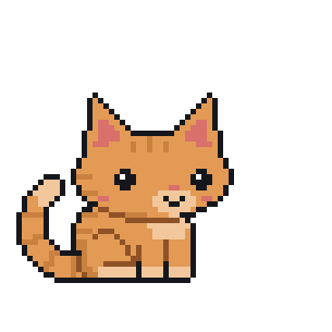

# SCat: Source Control Cat

A pixel-art cat that keeps an eye on your team's repos, so you don't have to.

> **Status: still a kitten (work in progress)**. It can already hear GitHub knocking (webhooks are received and verified), but it hasn't learned any tricks yet. See [Roadmap](#roadmap)

*Despite the name, please don't shoo the cat :p*

<p align="left">
  
</p>

## The idea

Most GitHub notifications end up in an inbox nobody reads. SCat puts them on a small cat that sits in the corner of your screen:

| What happens on GitHub | What the cat does |
|---|---|
| A teammate pushes to a branch you track | Watches it fly by: *"{name} pushed to {branch}"* ✈️ |
| Your review is requested on a PR | A PR bubble pops up and the cat gets super curious 👀 |
| A PR gets merged | Happy little celebration 🎉 |
| CI fails | Gets sick, and perks back up once it passes again 🤒 |
| Nothing happens for a while | Curls up for a nap 💤 |

The desktop version will also react to your own local work. Commits you haven't pushed yet pile up as a stack of papers next to the cat, and when you push, the cat sends them off.

## Under the fur...

```
GitHub ──webhook──► Express backend ──► mood rules ──SSE──► cat (browser / desktop)
                    (verifies HMAC)     (event → state)
```

1. GitHub sends a webhook to the backend for every event in a watched repo.
2. The backend checks the request's HMAC-SHA256 signature, so it only trusts events that really came from GitHub ([details](backend/docs/webhooks.md)).
3. Pure rule functions turn each event into a cat state, for example a failed `workflow_run` becomes `sick`.
4. The new state is pushed to the frontend over Server-Sent Events, and the cat plays the matching animation.

The cat first runs in a floating browser window (Document Picture-in-Picture, Chrome/Edge). Later in v2 it becomes a transparent, always-on-top lightweight desktop app built with Tauri.

## Tech stack

- **Backend:** TypeScript, Node.js, Express 5, Vitest, ESLint + Prettier
- **Frontend (planned for v1):** React + TypeScript
- **Database (planned for v1):** PostgreSQL
- **Desktop (planned for v2):** Tauri
- **Sprites:** a dependency-free Python script. Each frame is a grid of palette characters that gets exported to sprite sheets and a JSON atlas.

## Repository layout

```
backend/                 Express API (TypeScript)
  src/controllers/       route handlers (health, webhooks)
  src/utils/config.ts    env var loading and validation
  docs/                  backend docs (webhooks, signature verification)
  smee.mjs               dev relay: forwards GitHub webhooks to localhost
frontend/public/sprites/ exported sprite sheets + atlas.json
sprite-tools/            sprite source (scat_sprites.py) and preview page
```

## Running locally

Requires Node.js and a GitHub repo you can add a webhook to.

```bash
cd backend
npm install
```

Create `backend/.env`:

```
PORT=3003
SMEE_URL=https://smee.io/your-channel
WEBHOOK_SECRET=the-same-secret-as-in-github
```

Then run these in two terminals:

```bash
npm run dev     # API with hot reload
npm run smee    # forwards GitHub webhooks to localhost
```

Setting up the webhook on GitHub, and what each response code means, are covered in [backend/docs/webhooks.md](backend/docs/webhooks.md).

Other scripts: `npm test`, `npm run lint`, `npm run typecheck`, `npm run build`, `npm start`.

### Sprites

```bash
python3 sprite-tools/scat_sprites.py frontend/public/sprites
```

This regenerates `cat_sheet.png`, `overlays_sheet.png` and `atlas.json`. Open `preview.html` in that folder to see every animation.

## Roadmap

- [x] TypeScript backend with health check
- [x] Webhook endpoint with signature verification
- [x] Sprite set and export pipeline
- [ ] Mood rules (event → cat state) with tests on real saved payloads
- [ ] PostgreSQL storage for followed repos and events
- [ ] Live updates to the frontend over SSE
- [ ] React dashboard and floating mini-mode cat (MVP target, January 2027)
- [ ] Tauri desktop pet with local git states (spring 2027)

## Credits

Designed and built by Karl-Martin Lokk. **All application code is hand-written**; AI has been used as a mentor for planning, learning, critique and for generating the sprite art from my designs.

## License

[MIT](LICENSE)
